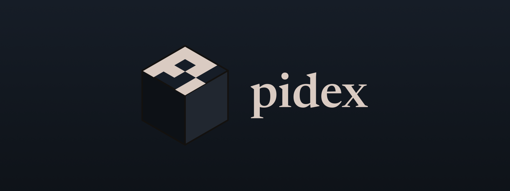
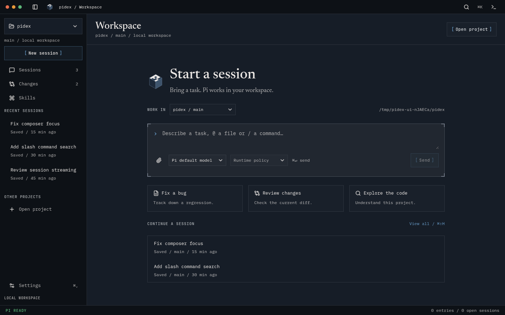
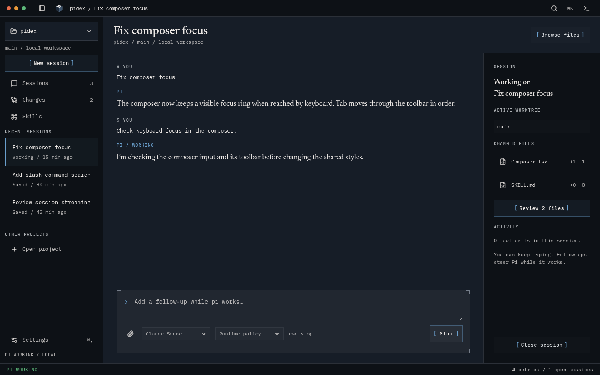
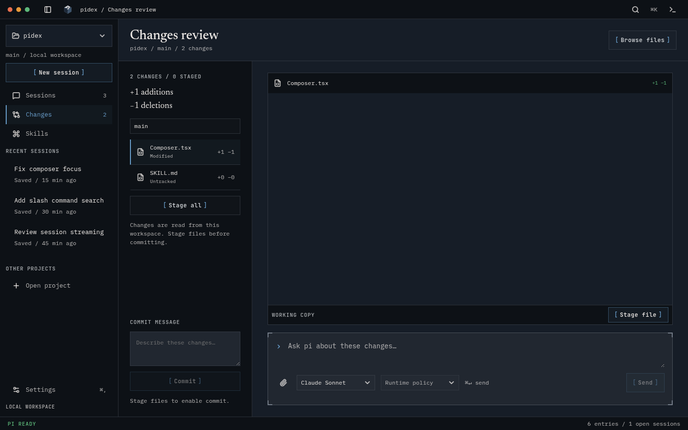
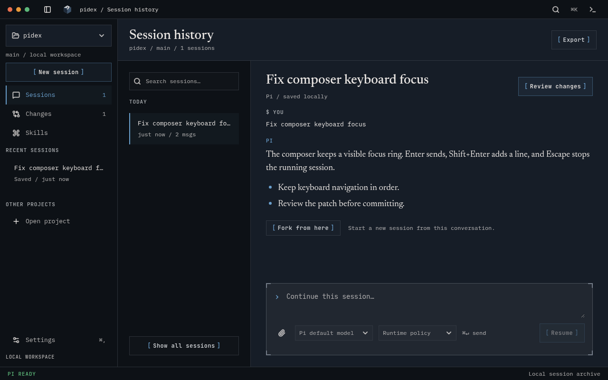
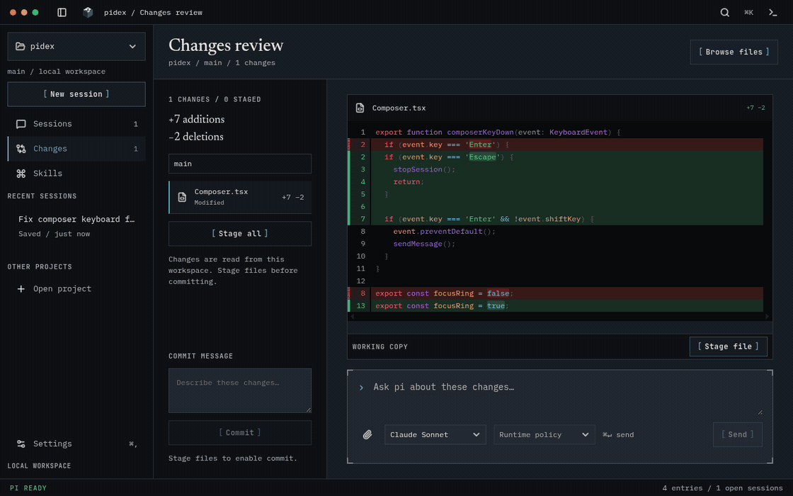

<div align="center">



**A desktop workbench for the Pi coding agent.**
**Workspace-first, not chat-first.**

[Install](#install) · [Quick Start](#quick-start) · [Architecture](docs/pidex-architecture.md) · [Distribution](docs/distribution.md)

[](https://github.com/echohello-dev/pidex/actions/workflows/ci.yml)
[](https://github.com/echohello-dev/pidex/releases/latest)
[](LICENSE)
[](https://www.electronjs.org/)
[](https://react.dev/)
[](https://www.typescriptlang.org/)

</div>

## Why this exists

Daily coding-agent work means juggling repos, branches, and sessions. pidex keeps the workspace in view: pick a repo, continue a session, inspect files, and review the changes Pi made.

## In action

| Start a session | Work with Pi |
| :---: | :---: |
| [](docs/assets/workbench-boot.png) | [](docs/assets/workbench-loaded.png) |
| Choose a workspace and model, or continue recent work. | Keep the conversation, branch, and changed files together. |
| **Review changes** | **Recover context** |
| [](docs/assets/workbench-changes.png) | [](docs/assets/workbench-history.png) |
| Inspect added and removed lines before staging a file. | Read saved conversations before resuming or forking. |

Click any screenshot for the full-size capture.

### Review → stage → unstage



The selected file stays in view as it moves between the working copy and the index. Staged and unstaged changes have separate patches; empty and binary changes show an explanation.

These are captures of real Electron interactions with a temporary Git workspace and deterministic Pi responses. The GIF shows actual staging and unstaging, verified against Git's index. [Refresh the media](docs/media.md) with `mise run docs:media`.

## What works today

- Group existing local folders into named workspaces and discover Pi sessions by their original working directory.
- Start, stop, steer, resume, and fork sessions; preview history before launching Pi.
- Browse linked session archives and branch entries; preview and continue the selected path.
- Render streamed Markdown, thinking, and expandable tool output.
- Browse files, review diffs, stage changes, and commit.
- Discover workspace and global skills, switch models, and save model and reasoning defaults per workspace.
- Switch roots while sessions run in the background; retain per-root drafts, views and model defaults.
- Use quick switch for roots, sessions, files, and commands.

Expanded tool cards show output first. Open Input or close Output independently, and copy either section while it is closed. These choices stay with each card while scrolling through the transcript; reopening the transcript resets them.

Session history shows source/fork relationships and an entry tree with selected and archive-tip markers. Select a branch tip or an earlier entry to preview its parent chain. Resume at the archive tip continues in place; **Resume in new fork** continues a historical selection in a separate archive and preserves the source. **Fork from here** uses the selected entry. Pi 1.5.0 RPC does not expose arbitrary-entry navigation, so forks extract a native branch archive before launching Pi so even runtime startup writes preserve the source. Continuation requires an intact Pi v3 archive within the 16 MiB browsing limit. See [ADR 0013](docs/adr/0013-session-branch-selection.md) for runtime semantics and limits.

Saved history includes a collapsible summary of the selected path, with the latest request and reply, message counts and tool outcomes. Unfinished tool calls carry a reminder to review the workspace before retrying. Selecting another branch or an earlier entry updates the summary.

Use **Copy context** in History to put the selected path's Markdown handoff on the clipboard, or **Export** to save it as a file. Both include the original root, model, messages, thinking and tool input/output. Open the destination root and paste the context into a new session there. This transfers context; saved history and Resume stay with the original root.

Use **Create workspace** or **Edit workspace** in the sidebar to name a group and select its roots. **Add root** chooses an existing folder. Each session runs in one root; the composer shows its path. Switching roots leaves open sessions running and makes them available under **Open sessions**. Files, Changes, History and defaults remain scoped to the selected root. A missing folder retains readable history, but cannot start or resume Pi until its original path is available. Adding another folder does not relocate a session. Group membership does not change Pi's tool permissions or load sibling roots into its context.

Existing `workspaces.json` and `session-defaults.json` records migrate to `workspace-registry.json` in Electron userData. Original files and `.bak` copies remain intact. Workspace groups and selection persist; live processes and drafts do not restart after app quit. A package folder shares its Git worktree's index: pidex refuses its commit when staged changes exist outside that folder. Open the repository top level to review the whole index.

Active sessions and history use a virtualized transcript. A local development benchmark with 4,500 mixed entries opened in about 1.4 seconds, down from 8.3 seconds, and mounted fewer than 100 transcript DOM nodes instead of 39,000. Timings vary by machine and load; see [ADR 0011](docs/adr/0011-virtualized-transcript.md) for the method and limits.

Automatic repository/worktree grouping, group-wide history and folder-to-folder context transfer remain on the [issue tracker](https://github.com/echohello-dev/pidex/issues).

## Install

Install the [Pi CLI](https://pi.dev/) and configure your provider through Pi first. pidex uses your local Pi runtime and reads saved sessions from `~/.pi/agent/sessions`. It does not bundle Pi or provider credentials.

### macOS

```bash
$ brew tap echohello-dev/tap
$ brew install --cask pidex
```

Or download `pidex-mac-arm64.dmg` (Apple silicon) or `pidex-mac-x64.dmg` (Intel) from [Releases](https://github.com/echohello-dev/pidex/releases/latest). Signing depends on the release configuration. If macOS blocks an unsigned build, use right-click → Open. See [distribution and signing](docs/distribution.md#signing).

### Windows

The [echohello-dev tap](https://github.com/echohello-dev/homebrew-tap) is the Winget source until `echoHello.Pidex` is in the community repo. WinGet cannot add a GitHub repo directly, so the tap ships a one-liner that installs the latest manifest:

```powershell
> irm https://raw.githubusercontent.com/echohello-dev/homebrew-tap/main/winget/install-pidex.ps1 | iex
```

Scoop from the same tap:

```powershell
> scoop bucket add echohello https://github.com/echohello-dev/homebrew-tap
> scoop install pidex
```

Or download `pidex-win-x64.exe` from [Releases](https://github.com/echohello-dev/pidex/releases/latest).

### Linux

```bash
$ curl -sL -o pidex.AppImage \
    https://github.com/echohello-dev/pidex/releases/latest/download/pidex-linux-x86_64.AppImage
$ chmod +x pidex.AppImage && ./pidex.AppImage
```

A `.deb` and a GHCR image (`ghcr.io/echohello-dev/pidex`) ship alongside. Docker needs an X11 socket; prefer the AppImage on a real desktop. Full matrix in [docs/distribution.md](docs/distribution.md).

Releases use Release Please PRs with CalVer tags (`YYYY.0M.0D`, with `-N` for another release that day). Merging the release PR builds and publishes the installers. See the [release workflow](docs/distribution.md#release-workflow).

## Quick Start

From source, use [mise](https://mise.jdx.dev/) to install the Node and Bun versions pinned in `.mise.toml`. Git is needed for workspace changes and commits.

```bash
$ git clone git@github.com:echohello-dev/pidex.git && cd pidex
$ mise install
$ bun install
$ mise run dev          # starts Vite + Electron
```

`mise run build` runs lint, typechecking, unit and component tests, then compiles the app. `mise run package` bundles native installers for your platform. Source checkouts use the Vite server; installed builds load their bundled renderer.

If the app cannot find Pi, set `PIDEX_PI` to its absolute executable path before launching. Tool access and provider credentials are managed by Pi; pidex does not add a separate permission sandbox.

### Tests

```bash
$ bun run test:unit         # parsers, session archives, workspace and skill discovery
$ bun run test:integration  # React component behavior in jsdom
$ mise run test:e2e         # real Electron UI; Linux needs an X display
```

The E2E suite compiles main/preload, starts an isolated renderer server on a free port, and creates temporary Git workspaces, sessions, and app settings. It uses a deterministic Pi RPC fixture, so it needs no Pi installation or provider credentials and does not validate live provider calls. Screenshots are written to `test-results/workbench/`. Every PR runs all three test lanes; `mise run build` also runs lint, typecheck, unit and component tests.

The long-session suite opens 4,500 mixed transcript entries and checks streaming, keyboard and wheel scrolling, text selection, focused links, expansion, and resize behavior. It writes timing observations and screenshots to `test-results/long-session/`. See [ADR 0011](docs/adr/0011-virtualized-transcript.md) for the measurement approach and tradeoffs.

## Architecture

```
┌────────────────────────────────────────┐
│  Renderer (React 19)                   │   ← dashboard, session tabs, timeline
└───────────────────┬────────────────────┘
                    │  typed IPC (window.pidex)
┌───────────────────▼────────────────────┐
│  Main process (Electron)               │   ← workspace registry, event normalization
└───────────────────┬────────────────────┘
                    │  NDJSON over stdio
┌───────────────────▼────────────────────┐
│  Pi runtime (`pi --mode rpc`)          │   ← one supervised subprocess per session
└────────────────────────────────────────┘
```

Pi runs out of process over RPC. The main process supervises its lifecycle and forwards events through the preload bridge; the renderer reduces them into transcript entries. TanStack Virtual mounts visible entries with overscan, Pretext supplies cached height estimates, and ResizeObserver measures rendered Markdown and expanded tools.

Browser Find and Select All cover mounted transcript text. Reopening a transcript resets its scroll position and expanded cards. Full-session search, persistent reading position, and virtualization within a single huge message remain future work.

Read the [architecture](docs/pidex-architecture.md), [project direction](docs/pidex-project-brief.md), and [decision records](docs/adr/README.md).

## Built on

| Layer | Choice |
|---|---|
| Shell | Electron 41, context-isolated, typed `window.pidex` preload bridge |
| UI | React 19.2, Vite 8 with HMR |
| Transcript | TanStack Virtual, cached Pretext estimates, ResizeObserver measurements |
| Content | markdown-it for Markdown, @pierre/diffs for patches |
| Language | TypeScript 6 |
| Package manager | Bun |
| Toolchain | mise, all commands via `mise run` |

## License

[Apache-2.0](./LICENSE): see the file for full text. Personal project, shared in the open.

## Star History

<a href="https://star-history.com/#echohello-dev/pidex&Date">
  <picture>
    <source media="(prefers-color-scheme: dark)" srcset="https://api.star-history.com/svg?repos=echohello-dev/pidex&type=Date&theme=dark" />
    <source media="(prefers-color-scheme: light)" srcset="https://api.star-history.com/svg?repos=echohello-dev/pidex&type=Date" />
    
  </picture>
</a>
