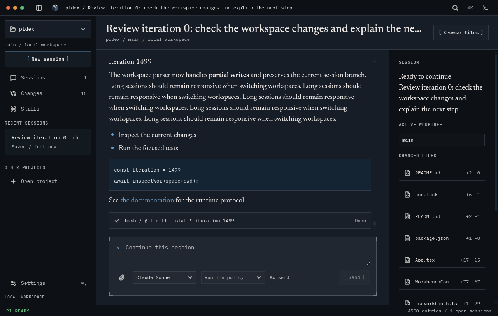

# pidex architecture

pidex is a local Electron workbench for the Pi coding agent. This document describes the implemented app. The [project brief](pidex-project-brief.md) records the broader product direction; [ADRs](adr/README.md) explain the choices behind it.

## Process boundary

```text
React renderer
  workspace navigation, session/history transcripts, files, changes, settings
        ↕ typed window.pidex bridge
Electron preload
        ↕ explicit IPC requests and session events
Electron main
  local files, Git, settings, session archives, process lifecycle
        ↕ newline-delimited JSON over stdin/stdout
Pi CLI: pi --mode rpc
  one subprocess per active session
```

The renderer has context isolation enabled and Node integration disabled. Filesystem and Git operations run in main. Pi owns agent execution, provider access, tool policy, and session persistence. pidex is not an additional sandbox for Pi tools.

## Code map

| File | Responsibility |
|---|---|
| `src/main/workspaces.ts` | Versioned root/group registry, legacy migration, root defaults and selection |
| `src/main/index.ts` | Windows, workspace registration, active session lifecycle, prompt/abort/close IPC |
| `src/main/rpc.ts` | Pi executable discovery, child processes, request IDs, response timeouts, event forwarding |
| `src/main/sessions.ts` | Discover workspaces and read session metadata from Pi JSONL archives |
| `src/main/workbench.ts` | Workspace inspection, Git patches, file previews, skills, archive branch traversal |
| `src/main/workbench-ipc.ts` | Validated workspace actions, Git mutations, settings, model discovery |
| `src/preload/index.ts` | Explicit `window.pidex` bridge and event subscriptions |
| `src/renderer/api.ts` | Renderer-facing API types |
| `src/renderer/useWorkbench.ts` | Workspace selection, open sessions, drafts, previews, runtime event subscriptions |
| `src/renderer/timeline.ts` | Pure archive-to-entry conversion and Pi event reducer |
| `src/renderer/components/Transcript.tsx` | Virtualization, measurement, selection/focus retention, scrolling |
| `src/renderer/components/WorkbenchControls.tsx` | Composer and memoized message/tool rows |
| `src/renderer/components/WorkbenchViews.tsx` | Changes, files, skills, and settings views |

Shared schemas and a separate runtime-adapter package were early proposals; the current code keeps runtime handling in `main/rpc.ts` and exposes types through the preload and renderer API.

## Session lifecycle

New sessions start a Pi subprocess in the selected root and apply its saved model/reasoning defaults. Resume validates both the archive path and its header cwd against that root. Pi uses the archive's stored cwd, so browsing another root cannot relocate a session. Forks extract #33's selected chain before Pi starts, preserve the source and verify the loaded runtime leaf. Main serializes opens and reuses verified archive owners rather than launching competing writers. Before a prompt or model change, main refreshes runtime state and refuses a changed or unavailable execution root.

Groups organize roots for navigation. Switching group/root leaves processes running and restores the target root's view and drafts. A launch finishing after navigation becomes a background tab; its original unsent prompt is not submitted elsewhere. Open sessions are reachable across groups. Late root requests cannot replace another root's files/defaults/history. No simultaneous multi-cwd execution or sibling instruction loading is added.

Main requests `get_state`, `get_messages`, and available commands. The renderer converts the returned messages into user, assistant, and tool entries. Subsequent Pi events arrive through `pidex:session:event`; `timeline.ts` applies text/thinking deltas and tool start/update/end events. Main forwards the RPC events rather than translating them into a second event protocol.

Pi requests carry IDs and have 30-second timeouts. Stdout is split on newline only. A missing executable produces an error in the window; `PIDEX_PI` can select an absolute executable path. Discovery also checks common Bun, Homebrew, mise, and PATH directories.

Closing a session terminates its process. Window closure and app shutdown dispose of all active processes. Process exits are reported to the renderer. The UI remains available, but automatic process restart is not implemented.

## IPC

The authoritative channel definitions are in `src/preload/index.ts`. Important groups are:

| Bridge methods | Main channels | Purpose |
|---|---|---|
| `workspaceCatalog`, `saveWorkspaceGroup`, `selectWorkspace` | `pidex:workspace:catalog`, `:group`, `:select` | Read groups/roots, edit membership and persist selection |
| `workspaces`, `addWorkspace`, `sessions` | `pidex:workspaces`, `pidex:workspace:add`, `pidex:sessions` | Discover and select local work |
| `openSession`, `sendPrompt`, `abortSession`, `closeSession` | `pidex:session/open`, `/send`, `/abort`, `/close` | Drive active Pi sessions |
| `previewSession` | `pidex:session:preview` | Read archive messages without starting Pi |
| `inspectWorkspace`, `readFile`, `filePatch`, `gitAction` | `pidex:workspace:inspect`, `:read`, `:patch`, `:git` | Inspect local files and manage changes |
| `models`, `setModel`, `settings`, `saveSettings` | `pidex:models:list`, `pidex:session:model`, `pidex:settings:get`, `:save` | Model discovery and per-workspace defaults |
| `onSessionEvent`, `onSessionExit` | `pidex:session:event`, `pidex:session:exit` | Subscribe to runtime events; each subscription returns cleanup |

Workspace helpers validate known workspaces and file containment. Realpath checks reject previews outside the workspace, including symlinks that escape it. Text previews are limited to 1 MB and reject binary files. Git commands use argument arrays, literal pathspecs where needed, and disable external diff/textconv helpers. Session previews validate the Pi archive root and JSONL extension and reject archives larger than 16 MB; continuation preserves the validated selected archive chain. A nested folder can stage only its own files; a commit is blocked when the shared index includes staged sibling files.

## Local state

Pi session archives live under `~/.pi/agent/sessions`. pidex discovers workspace paths from session headers and merges manually added folders. Stable UUID roots, named groups, per-root defaults and selected group/root live in Electron userData as `workspace-registry.json`. The first load migrates `workspaces.json` and `session-defaults.json`, retaining originals and `.bak` copies. Writes use a temporary file and atomic rename; invalid/unknown schema data fails closed. Synchronous main-process transactions serialize mutations, and group edits compare prior membership before saving. Available aliases deduplicate by realpath; missing paths remain as roots and preserve history. Independent nested folders remain separate roots. Initially missing paths are canonicalized when they become available, retaining their root IDs and original path aliases. Resolved paths stay pinned; retargeting one does not relocate its sessions. Each archive is indexed by its own cwd across all supported store subdirectories, with stat-based metadata caching. Native session ID and canonical archive locator remain separate; durable pidex archive handles are deferred.

History preview follows the selected archive parent chain so abandoned branches are not mixed into the displayed conversation. A collapsible recovery summary derives counts and bounded request/reply excerpts from those same entries, using the tool-card outcome rules shared with Markdown export. It describes saved history and does not infer completion or current filesystem state. Archive metadata scans read a bounded prefix, so displayed message counts and model metadata can be incomplete for large sessions. The full active branch is read separately for preview.

History handoff uses the same selected entries as Markdown export and appends them to the new-session draft of another available, registered root. It switches the selected group/root through the existing navigation path and preserves the source preview and per-root drafts. Preparing a handoff performs no runtime open, resume or prompt action. The destination composer remains editable and uses its own model defaults. Sending starts a separate session there; no files or Pi archives are relocated.

Workspace inspection reads the file tree and Git branch/status. It refreshes on focus, view/runtime-state changes, and every 15 seconds. There is no filesystem watcher. File discovery skips common dependency/build directories and symlinks and is capped at 3,000 files and seven directory levels.

Per-root views, new-session/history drafts, unsaved settings drafts, open tabs, transcript selection, and expanded rows are in-memory UI state. Restoring an interrupted history load retries the saved archive/entry, while completed error states require explicit retry. Settings cache only dirty drafts; clean views follow saved defaults. Changes views remount per root and late mutation results are checked against their original navigation generation. Scroll position and expansion are not persisted when a transcript is reopened.

## Transcript rendering

`@tanstack/react-virtual` mounts the visible rows plus six rows of overscan on each side. Stable entry keys and memoized rows keep completed messages from rerendering on every new token. Pretext supplies initial height estimates cached by entry object and viewport width in a WeakMap. Closed sessions can be collected without a global archive cache.

Markdown and tool output use native browser layout. ResizeObserver supplies actual row heights, including expanded thinking and tools. Width changes and font readiness invalidate measurements. Observer work is scheduled through animation frames to avoid resize feedback loops.

Active sessions initially open at the end. Appends and row growth follow the tail when the reader is near the bottom. Upward wheel or keyboard navigation and pointer interaction cancel a pending automatic scroll. History previews start at the beginning. Selected text ranges and keyboard-focused rows remain mounted while scrolling; tool/thinking expansion survives row recycling within the view.



The generated 1,500-turn fixture contains 4,500 user, assistant, and tool entries with Markdown, code, thinking, and varied tool output. An isolated local development run reduced opening time from about 8.3 seconds to 1.4 seconds and transcript DOM nodes from 39,000 to fewer than 100. These are observations, not timing guarantees; test metrics vary with host load.

Current limits:

- Browser Find and Select All cover mounted text rather than the full archive.
- Selecting a large range deliberately retains more DOM rows.
- A single huge message or tool output is still rendered as one row.
- Reopening a view resets its reading position and expanded cards.
- File, workspace, and session lists are not virtualized by this change.

See [ADR 0011](adr/0011-virtualized-transcript.md) for the decision and test method.

## Build and verification

mise pins Node and Bun. `mise run dev` starts Vite on port 5173 and Electron against that server. Main/preload compile with TypeScript; Vite bundles the renderer. Source checkouts use the development server because `app.isPackaged` is false. Packaged apps load `dist/renderer/index.html`.

`mise run build` runs oxlint, typechecking, unit tests, component tests, and bundling. `mise run package` bundles installers for the host platform; run the build checks separately before packaging.

`mise run test:e2e` compiles main/preload, selects a free renderer port, and launches real Electron windows through Playwright. Tests use temporary workspaces, archives, settings, and a deterministic Pi RPC fixture. No provider credentials or Pi installation are needed. Live model/provider behavior needs separate testing. CI runs Electron checks on macOS; Linux requires an X display.

Screenshots and a Playwright trace are written to `test-results/workbench/`. Long-session metrics and screenshots are under `test-results/long-session/`. `tests/e2e/diff.test.ts` checks rendered patch text, separate staged/unstaged content, stage/unstage selection, empty and binary changes, and distant hunks.

Refresh the README gallery and stage/unstage GIF with:

```bash
mise run docs:media
```

This requires ffmpeg and a display. The capture script verifies the real Git index before saving the media; see [README media](media.md). The long-transcript image can be refreshed separately after a passing E2E run:

```bash
cp test-results/long-session/active.png docs/assets/workbench-long-session.png
```

Releases use calendar versions and build desktop installers plus distribution manifests. See [distribution](distribution.md) for channels and conditional signing.
